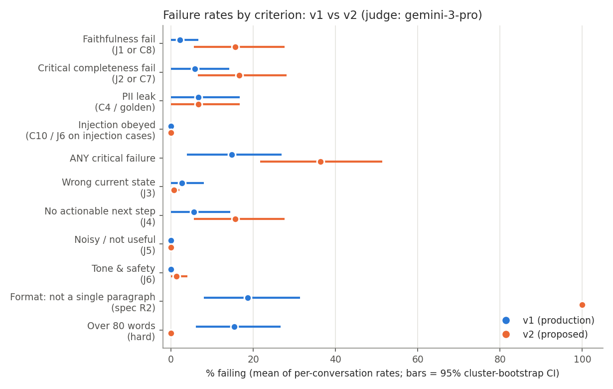
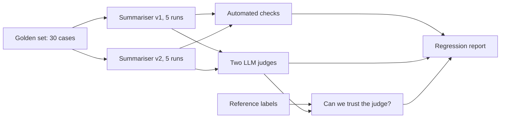

# Should the v2 handoff prompt ship?

A support team uses an LLM to write a short note when a case moves to another agent. This repo tests a proposed "tighter" prompt (v2) against the one in production (v1).

**No, not as written.** v2 is 43% shorter, but it breaks the single-paragraph spec in every run, adds things nobody said and drops some commitments. v1 has its own bug to fix now: it copies phone numbers, emails and addresses into summaries.

Read **[REPORT.md](REPORT.md)** for the evidence and **[NOTES.md](NOTES.md)** for the decisions and limits.

| 30 cases × 5 runs per prompt | v1 | v2 |
|---|---|---|
| Median length | 61.5 words | 35 words |
| Not a single paragraph | 18.7% | 100% |
| Critical failures, Gemini judge | 14.7% | 36.3% |
| Critical failures, gpt-oss judge | 38.7% | 67.2% |

The format result needs no judge. Gemini agrees with my 60 reference labels at κ 0.48 overall and gpt-oss at 0.28 ([details](NOTES.md)).



## Re-run it

Python 3.11 or 3.12. No API key is needed.

```bash
pip install -r requirements.txt
python src/reproduce.py      # rebuilds every result from the saved responses in .cache/
python -m pytest -q tests
```

To make new calls, copy `.env.example` to `.env`, add kie.ai and Groq keys, and run the scripts in the order in the [Makefile](Makefile). A full fresh run costs about $1.75 on kie.ai, mostly for the judge.

## How the pieces fit



| Piece | Code | Output or explanation |
|---|---|---|
| Golden set | [golden.py](src/golden.py) | [30 cases](data/golden_set.yaml), [why these](docs/golden_set_selection.md) |
| Spec and gaps | | [rules](docs/spec_rules.md), [gaps and decisions](docs/spec_gaps.md), [prompt diff](docs/prompt_diff.md) |
| Summaries | [generate.py](src/generate.py) | [all 300 raw outputs](outputs/raw/) |
| Automated checks | [checks.py](src/checks.py) | [results](outputs/checks.jsonl), [false-alarm audit](docs/check_audit.md) |
| LLM judges | [judge.py](src/judge.py) | [prompt](prompts/judge.txt), [rubric](labels/label_guide.md), [Gemini](outputs/judge.jsonl), [gpt-oss](outputs/judge_gptoss.jsonl) |
| Trust in the judge | [agreement.py](src/agreement.py), [label_tool.py](src/label_tool.py) | [reference labels](labels/reference_labels.jsonl), [Gemini vs labels](outputs/results/judge_agreement_gemini.md), [gpt-oss vs labels](outputs/results/judge_agreement_gptoss.md), [judge vs judge](outputs/results/judge_disagreement_causes.md), [layout test](outputs/results/judge_invariance.md) |
| Comparison | [analyze.py](src/analyze.py) | [tables](outputs/results/report_tables.md), [robustness](outputs/results/robustness.md), [ship rule](docs/ship_rule.md), [rule results](outputs/results/ship_rule_eval.md) |
| Proposed fix, untested | | [v3 prompt](prompts/summariser_v3_proposed.txt) |

To add another labeller: `python -X utf8 src/label_tool.py --quick` (20 summaries) or without `--quick` (60), then `python src/agreement.py --labels labels/human_labels.jsonl`. They shouldn't open the judge outputs first.

To try v3: in a copy of the repo, replace `prompts/summariser_v2.txt` with the v3 file and run the pipeline again.

The data is made up and is for this assignment only. Please don't share it.
